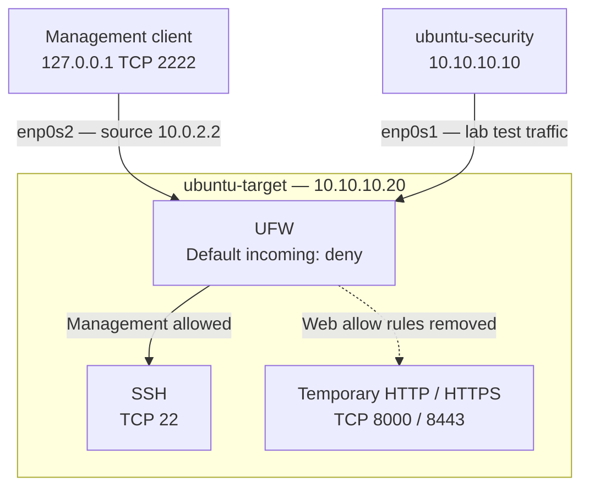

# Network architecture

The lab uses two Ubuntu virtual machines in UTM: an assessment client and a target server. Administrative SSH reaches the target through a separate host forwarding path. The diagram distinguishes the recorded test destination from management access.

The final scan from `ubuntu-security` classified TCP 22, 8000 and 8443 as filtered. The temporary web services had no listeners in the separate target listing; their boxes show their lab role, not running services in the final state.

## Assessment path

The scans target `10.10.10.20` from the assessment VM. Before temporary web allow rules were removed, TCP 8000 and 8443 returned `closed`, while TCP 22 was `filtered`. After cleanup, all three were `filtered` in the recovered final scan.

These states apply to the tested path and time. The TCP listeners were inspected separately on the target. That listing contained SSH at `0.0.0.0:22` and `[::]:22`, with local DNS at `127.0.0.53:53` and `127.0.0.54:53`. It contained no listener on TCP 8000 or 8443.

The pasted target UFW rules during TLS testing allowed TCP 8000 and 8443 on `enp0s1` from `10.10.10.10`. The final UFW screenshot showed those temporary rules removed, UFW active, a default incoming policy of deny, an outgoing policy of allow, routed filtering shown as disabled, and only the SSH management rule remaining. The final default policies do not establish a tested routing or IPv6 security boundary.

## Management path

The recorded workflow uses the host endpoint `127.0.0.1:2222` to reach target SSH. The directly inspected final firewall screenshot shows `22/tcp on enp0s2 ALLOW IN 10.0.2.2`. The participant confirmed a new administrative connection still returned `student` and `ubuntu-target` after cleanup, while the assessment VM's SSH probes remained filtered.

This diagram does not assign an unverified target management IP, subnet mask or exact UTM network mode. It is a logical view of the documented paths, not a complete virtual-switch configuration export. The `10.10.10.10` and `10.10.10.20` addresses alone do not prove a particular subnet prefix or isolation boundary.

## Content and permission boundary

The directly inspected HTTP screenshots show that `http://10.10.10.20:8000/reports/internal-report.txt` returned `CONFIDENTIAL - Simulated Company Report` before relocation and `404 File not found` afterward. The lab workflow moved the report to `~/company-private/internal-report.txt`, outside the served directory. The owner account is `student`. The recorded final permissions were described as directory `700` and file `600`. The original HTTP screenshots were not retained in the public evidence bundle; their observations are recorded in the evidence register.

For a directory, `r` lists names, `w` permits modifying directory entries when the necessary traversal permission is also available, and `x` permits searching/traversing the directory. For a regular file, `r` reads its content, `w` modifies it, and `x` allows execution when the other requirements are satisfied.

The parent `/home/student` was already reported as `750`. A user outside the relevant owner/group could therefore be blocked before reaching `company-private`. The access-denied test does not independently prove that changing the child directory/file modes was the first effective barrier.

## Boundaries not established by the recovered scans

The final three-port scan does not establish full network isolation, the state of every TCP port, UDP filtering, IPv6 reachability or accessibility from other source addresses. The test VM and management client must be labelled separately in any future evidence capture so their results are not confused.
